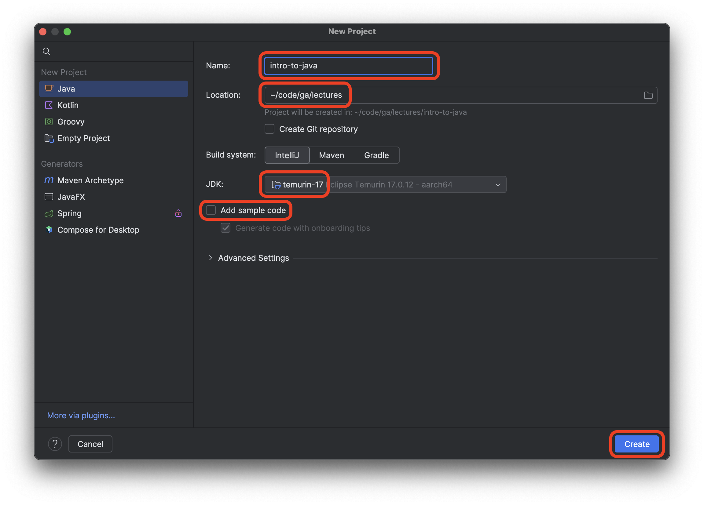
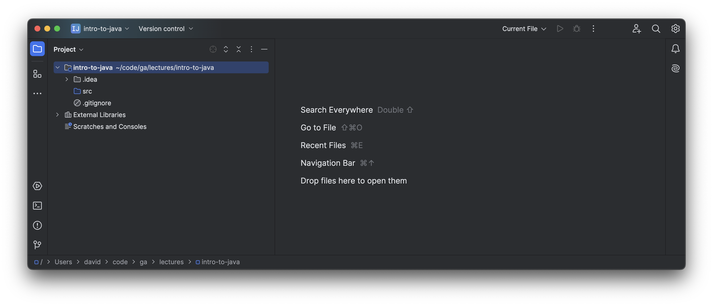

<h1>
  Intro to Java
  Setup
</h1>

  <h2>Setup</h2>
  5 min

Launch the IntelliJ IDEA application.

Select the **New Project** option.

Name the project `into-to-java`.

Create the project in the <code class="filepath">~/code/ga/lectures</code> directory.

> ⚠️ Windows users, the <code class="filepath">lectures</code> directory is likely at this location on your device: <code class="filepath">C:\Users\username\code\ga\lectures</code> (replacing `username` with your username). Create the project in that directory instead.

Ensure the JDK used is **temurin-17**. This should be the default setting when starting a new project. If it's not, alert your instructor.

Ensure that the **Add sample code** option is not checked.

After confirming the **New project** window looks similar to the screenshot below, select the **Create** button.

If everything goes according to plan, you'll see a new window like the one below.

Take the opportunity to note that the new project comes with a very basic file structure:

- <code class="filepath">.idea</code> holds some workspace configuration settings for the IntelliJ IDEA app.
- <code class="filepath">src</code> holds the Java code we write.
- A <code class="filepath">.gitignore</code> file with some sensible defaults pre-configured.

With that done, we're ready to write our first Java code!
