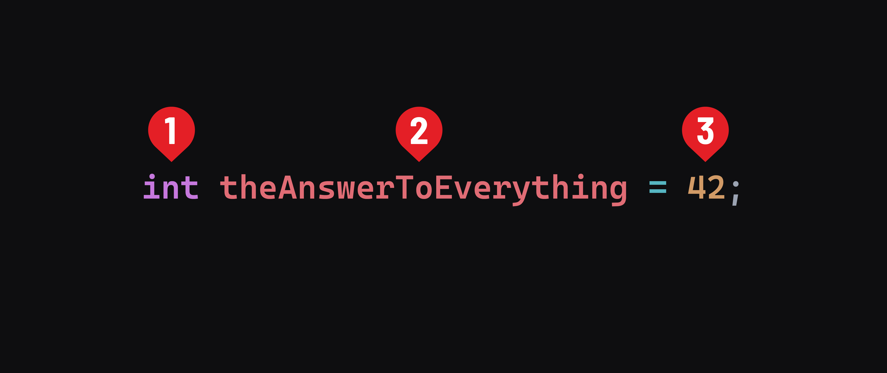

<h1>
  <span class="headline">Intro to Java</span>
  <span class="subhead">Variable Initialization</span>
</h1>

**Learning objective:** By the end of this lesson, students will be able to identify the syntax used to declare variables in Java allowing data to be easily referenced in an application.

## Initializing variables

To start writing more complex apps, we'll have to initialize variables at some point so that we're able to hold and reference data in our programs.

Creating a variable in Java requires us to define the data type of that variable by providing the type before the name of the variable. Here's the syntax:



1. The data type that will be stored in the declared variable.
2. The identifier (name) of the variable.
3. The value to be assigned to the variable. The data type of this value must match the data type we provided earlier.

Here are some more examples:

```java
double priceOfWater = 3.99;
String bestLanguage = "Java";
```

In Java, the standard practice is to initialize a value to a variable when it is declared if possible, but you are able to declare a variable without assigning anything to it and then initialize it later.

```java
int iWillBeSomethingOneDay
iWillBeSomethingOneDay = 100;
```

When you do this, it may be initialized with a default value depending on its data type. We'll learn more about all of Java's different data types soon, but these are the ones we see above:

- `int`: Short for integer; a whole number.
- `double`: A number with a decimal.
- `String`: Any combination of letters and words. `String` is an object data type, so it begins with a capital letter unlike `int` and `double`.

### Naming variables

Variable names are written in lower camel case, similar to how we wrote methods - each word is joined so there are no spaces or characters between them, and every word after the first word starts with a capital letter.

Variable names follow a few rules:

- They are case-sensitive.
- They cannot contain white space.
- They can be any length of letters, digits, dollar signs (`$`), and underscores (`_`).
- They should begin with a letter. Never start a variable with a `$` or `_` even though those are technically allowed. Variables cannot start with numbers.
- They cannot be [reserved words](https://en.wikipedia.org/wiki/List_of_Java_keywords).

<div class="activity pair-programming">
  <h2 class="title">Variable Declaration Practice</h2>
  <span class="minutes">10 min</span>
</div>

With a partner, take seven minutes to write these variables and print them to the console:

- How many minutes it takes to cook a pot of rice.
- The names of two famous landmarks and the countries where they are located.
- The price of a cup of coffee at a local cafe in your area.

We'll have a few pairs demo what they did when they're done.

🏗️ **Under Construction**

We are constantly working to improve our resources for instructors and students.

**Have something to contribute to this Instructor Guide?** [Let us know](https://git.generalassemb.ly/modular-curriculum-all-courses/universal-resources-internal/blob/main/module-feedback.md).
