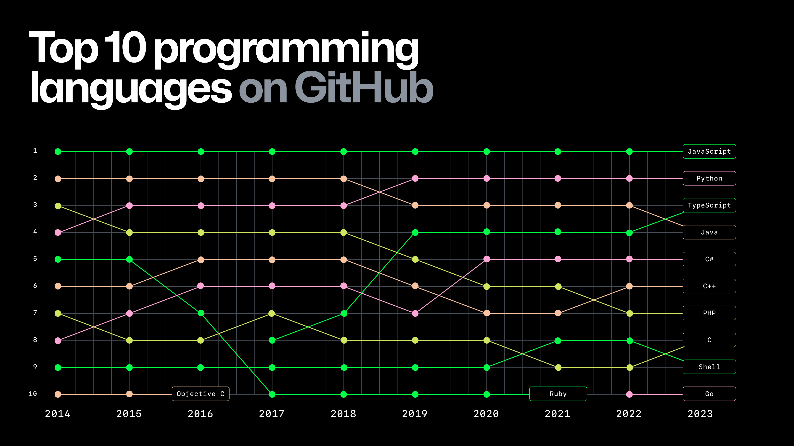

<h1>
  Intro to Java
  What is Java?
</h1>

**Learning objective**: By the end of this lesson, students will be able to describe the role of Java in software development, some of its unique qualities as a language, and its significance in the software industry.

  <h2>What is Java?</h2>
  10 min

Java is a programming language that was first released in 1996. It was developed at Sun Microsystems by [James Gosling](https://en.wikipedia.org/wiki/James_Gosling). He created it after seeing teams struggle with using the C and C++ languages effectively and set out to solve the shortcomings he perceived with those languages. Those solutions became a few of Java's headline features:

- Java code is highly portable. Developers can write Java code on any operating system or hardware architecture, which can be executed on any device using a Java virtual machine (JVM). This functionality inspired Java's "write once, run anywhere" slogan.
- Java has automatic garbage collection, so developers don't have to think about taking data out of a computer's memory after they're done working with it. Other techniques to help automatically manage computer memory are also used.
- Java is class-based and object-oriented from the ground up, not an optional added layer.
- Java supports multithreading at the language level to take advantage of modern hardware.

These features led to Java's quick adoption and sustained popularity, especially in enterprise environments. [GitHub's Octoverse 2023 report](https://github.blog/news-insights/research/the-state-of-open-source-and-ai/#the-most-popular-programming-languages) shows Java as the fourth most popular language on GitHub.

Today, Java is maintained by Oracle after it acquired Sun, but the problems James originally intended to solve still drive [the five core design goals of Java language](https://www.oracle.com/java/technologies/introduction-to-java.html):

1. Simple, object-oriented, and familiar
2. Robust and secure
3. Architecture-neutral and portable
4. High performance
5. Interpreted, threaded, and dynamic

### Duke

Java has an official mascot, Duke. Say hey, he doesn't bite!

