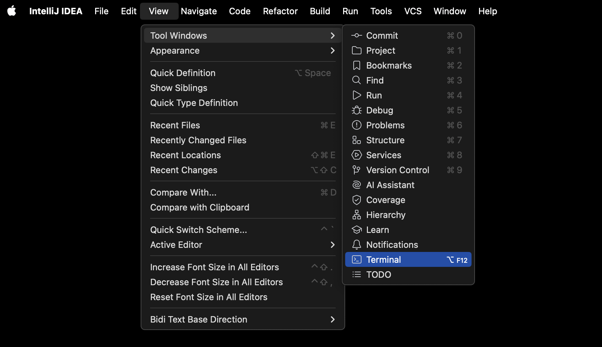

<h1>
  <span class="headline">Intro to Java</span>
  <span class="subhead">Writing Your First Java App</span>
</h1>

**Learning objective:** By the end of this lesson, students will be able to create Java files from the command line and construct a basic Java app.

<div class="activity guided-walkthrough">
  <h2 class="title">Howdy Partner</h2>
  <span class="minutes">15 min</span>
</div>

We'll build a classic app to get up to speed with any language - Howdy, Partner. We need a file to work in though, let's create one in IntelliJ's built-in terminal.

In the menu bar, select the **View** option. Find the **Tool Windows** option, then select **Terminal**.



> 🧠 You can also use a keyboard shortcut to open the terminal: <kbd>Option</kbd> + <kbd>F12</kbd> on macOS or <kbd>Alt</kbd> + <kbd>F12</kbd> on Windows and Linux.

The terminal will launch. The working directory will automatically be set to our project's directory as a handy bonus.

Create a file named <code class="filepath">HowdyPartner.java</code> inside the <code class="filepath">src</code> directory:

```bash
touch HowdyPartner.java
```

We'll work with more complex file structures as we make larger apps; for now, we'll stick with a simpler structure to get us going.

Return to the project in the GUI above the terminal and double-click the `HowdyPartner.java` file to open it.

All Java files must be defined as a `class`, so let's begin with a `class` definition. This `class` definition must match the name of the file, so we'll call ours `HowdyPartner`:

`HowdyPartner.java`

```java
public class HowdyPartner {
}
```

By convention, class names will be written in upper camel case (also referred to as Pascal case) - each word is joined so there are no spaces or characters between them, and every word starts with an uppercase letter.

Then, all Java programs require a `main()` method representing the program's entry point. This method will automatically be invoked when we run our Java file. The following method must be placed **inside** the `HowdyPartner` class definition:

`HowdyPartner.java`

```java
    public static void main(String[] args) {
    }
```

What's going on here?

### `public`

First, the `public` keyword, used for the `HowdyPartner` class and the `main()` method, declares these to be available anywhere. On the other hand, a `private` method or class would only be available to other members of the same  class. You can find more details [here](https://docs.oracle.com/javase/tutorial/java/javaOO/accesscontrol.html).

### `static`

Next, the `static` keyword indicates that this method belongs to the `HowdyPartner` class. The opposite of a `static` method would be an *instance* method, where the method belongs to the objects the class creates. To run an instance method, you must create a new class instance with the `new` keyword and call the method on the instantiated object.

### `void`

`void` indicates the data type of the method's return value, which will be nothing at all in the case of this method. Methods in Java require you to describe the data type of the return value of a method in their definition to enable future type-checking.

### `main()`

Finally, we can name our method. In this case, the `main()` method is absolutely required in Java programs and must be named `main`. By convention, methods will be named in lower camel case - each word is joined so there are no spaces or characters between them, and every word after the first word starts with a capital letter.

### `String[] args`

Inside the parentheses, you'll notice that the method takes in one parameter: `String[] args`. `String` indicates the type, and the array brackets tell the method to accept a list of `String`s. The parameter is named `args` by convention. This array represents any command line arguments you pass when running the method - even though the app we're writing won't do anything with these arguments they must be included.

This might be a lot to take in initially, but this syntax will become more manageable with practice. Let's write the one line of code that will do what we want: Print `Howdy, Partner!` to the console.

<div class="activity solo-exercise">
  <h2 class="title">Print <code>Howdy, Partner!</code> to the console</h2>
  <span class="minutes">2 min</span>
</div>

How do we do that? Take a moment to figure out how to print to the console by doing some independent research. You may want to use Google or an AI assistant.

## Comments

A quick note on comments. In Java, we have two options for writing comments:

```java
// I'm a single-line comment. Just lil ol' me.

/*
    I'm a multi-line comment.
    There are several of us.
    And we all get along fabulously.
*/
```

<div class="activity solo-exercise">
  <h2 class="title">Comment on your code so far</h2>
  <span class="minutes">5 min</span>
</div>

Jump back into `HowdyPartner.java` and add comments to your code explaining what the `class` definition means and what the `main()` method does in your own words, along with describing the syntax for each.
